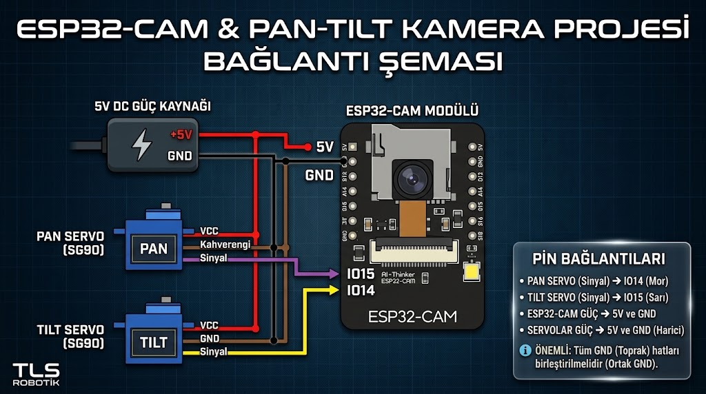
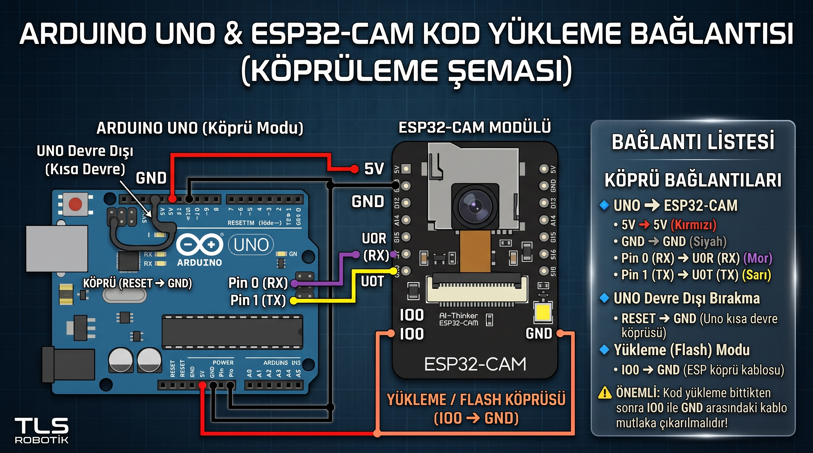

# ESP32-CAM ile Wi-Fi Kontrollü Pan-Tilt Kamera Sistemi

Bu proje, **AI-Thinker ESP32-CAM** modülü ve iki adet **SG90 servo motor** kullanılarak geliştirilmiş, yerel Wi-Fi ağı üzerinden canlı video yayını yapan ve web arayüzünden iki eksenli mekanik kontrol sağlayan gerçek zamanlı bir kamera sistemidir.

Projede video aktarımı ve servo komut iletimi **WebSocket** protokolü üzerinden asenkron olarak gerçekleştirilir. Kamera zamanlayıcıları (Timer) ile servo motor sinyallerinin çakışmasını önlemek amacıyla motorlar doğrudan ESP32'nin donanımsal **LEDC PWM** kanalları üzerinden sürülmektedir.

---

## 📌 Özellikler

* **Düşük Gecikmeli Canlı Yayın:** QVGA (320x240) çözünürlük ile WebSocket kuyruğunu şişirmeden saniyede ~25–30 FPS akıcı video akışı.
* **Donanımsal LEDC Servo Sürüşü:** Harici servo kütüphanelerinin kamera frekansıyla çakışmasını engelleyen bağımsız 50 Hz / 16-bit LEDC PWM kontrolü.
* **Mobil Uyumlu Web Arayüzü:** Herhangi bir mobil uygulama yüklemeye gerek kalmadan tarayıcı üzerinden Pan, Tilt ve Dahili Flaş (Parlaklık) kontrolü.
* **Yerel Erişim Noktası (Access Point):** Harici bir modeme ihtiyaç duymadan ESP32-CAM'in kendi yaydığı Wi-Fi ağı üzerinden bağlantı.
* **Kolay Programlama:** USB-TTL dönüştürücüye ihtiyaç duymadan standart bir **Arduino Uno** üzerinden köprüleme yöntemiyle kod yükleme desteği.

---

## 🛠️ Donanım Gereksinimleri

* 1x AI-Thinker ESP32-CAM Geliştirme Kartı (OV2640 Kamera Modülü ile)
* 2x SG90 9g Mikro Servo Motor
* 1x 2 Eksenli Pan-Tilt Kamera Mekanizması
* 1x Harici 5V / 2A DC Güç Kaynağı (Adaptör)
* 1x Arduino Uno R3 (Yalnızca kod yükleme köprüsü olarak)
* Breadboard ve Jumper Kablolar

---

## 📐 Devre ve Bağlantı Şemaları

### 1. Çalışma Devresi (Sistem Bağlantı Şeması)
Sistem çalışırken servoların ihtiyaç duyduğu ani akım dalgalanmalarının ESP32-CAM'i resetlemesini önlemek için harici 5V adaptör kullanılmalıdır. Tüm toprak (GND) hatları birleştirilmelidir.



### 2. Kod Yükleme Devresi (Arduino Uno Köprü Şeması)
ESP32-CAM üzerinde yerleşik bir USB-UART dönüştürücü bulunmadığından kod yükleme işlemi Arduino Uno köprülenerek gerçekleştirilir.

> ⚠️ **Önemli:** Kod yükleme sırasında ESP32-CAM üzerindeki **IO0** pini **GND**'ye bağlı olmalıdır. Yükleme tamamlandıktan sonra normal çalışma moduna geçmek için bu kablo çıkarılmalı ve karta Reset atılmalıdır.



---

## 🔌 Pin Bağlantı Tablosu

| Donanım | Pin / Hat | ESP32-CAM Pini | Açıklama |
| :--- | :--- | :--- | :--- |
| **Pan Servo (Yatay)** | Sinyal (Turuncu/Sarı) | `IO14` | LEDC Kanal 2 (50 Hz PWM) |
| **Tilt Servo (Dikey)** | Sinyal (Turuncu/Sarı) | `IO15` | LEDC Kanal 3 (50 Hz PWM) |
| **Dahili Flaş LED** | Dahili | `IO4` | LEDC Kanal 4 (1000 Hz PWM - Parlaklık) |
| **Güç Girişi** | +5V (Kırmızı) | `5V` | Harici 5V Güç Kaynağı |
| **Toprak Hattı** | GND (Siyah/Kahverengi)| `GND` | Ortak Toprak Hattı (Common GND) |

---

## 💻 Kurulum ve Yapılandırma

### 1. Arduino IDE ve Çekirdek Kurulumu
1. **Arduino IDE** yazılımını açın.
2. `File > Preferences > Additional Boards Manager URLs` kısmına şu adresi ekleyin:
   ```text
   [https://raw.githubusercontent.com/espressif/arduino-esp32/gh-pages/package_esp32_index.json](https://raw.githubusercontent.com/espressif/arduino-esp32/gh-pages/package_esp32_index.json)
